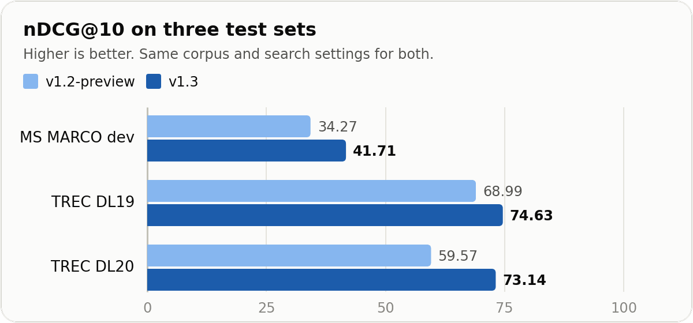

# BreadBowl-Embed v1.3

**Encode once. Retrieve and rerank from the same stored representation.**

An English retrieval model that stores each passage once, and uses the same stored vectors to find candidates and to rerank them.

- **As good as two models.** Level with Qwen3-Embedding-0.6B + Qwen3-Reranker-0.6B on MS MARCO and DL19, **+5.5 nDCG@10 on DL20**.
- **About 50× faster rerank.** 2.9 ms against 150 ms per query, same candidates, same GPU.
- **6 wins, 9 level, 0 losses** against released systems of similar size.

📄 **Paper:** [BreadBowl-Embed: Encode Once, Retrieve and Rerank](paper/breadbowl-embed-v1.3.pdf) (PDF)


## How it works

- A 0.8B-parameter text backbone reads the text once and pools it into **16 slots**.
- Each slot holds a **routing** vector and a **value** vector, 256 numbers each.
- **Find:** the query's routing vectors search the stored passage routing vectors.
- **Rerank:** the same routing match decides which stored value vectors the query reads.
- **Score** = 0.75 × routing + 0.25 × value. No cross-encoder, no second pass over the passage.
- Every passage costs the same 16 + 16 vectors, however long it is.

## Quick start

Python 3.12 or newer. Install the library from GitHub:

```bash
pip install "git+https://github.com/BreadBowlAI/breadbowl-embed.git"
```

```python
from breadbowl_embed import BreadBowl

model = BreadBowl.from_pretrained("dotproductx/breadbowl-embed-v1.3")
ids = ["octopus", "ocean", "plants"]
passages = ["Octopuses have three hearts.",
            "The Pacific is Earth's largest ocean.",
            "Plants use sunlight during photosynthesis."]

index = model.index(model.encode_documents(passages), ids=ids)  # encode once, keep
query = model.encode_queries(["How many hearts does an octopus have?"])
for hit in index.search(query, top_k=2)[0]:                     # retrieve, then rerank
    print(hit.id, round(hit.score, 3))
```

More examples (rerank a list, save an index, explain a score) are in the [library README](https://github.com/BreadBowlAI/breadbowl-embed).

## Results



| nDCG@10 | Models | Rerank | MS MARCO dev | TREC DL19 | TREC DL20 |
| --- | ---: | ---: | ---: | ---: | ---: |
| **v1.3** | **1** | **2.9 ms** | **41.7** | **74.6** | **73.1** |
| Qwen3-Embedding-0.6B + Qwen3-Reranker-0.6B | 2 | 200 ms | 41.9 | 72.0 | 67.6 ▼ |
| Jina v5 text-small + Qwen3-Reranker-0.6B | 2 | 200 ms | 42.0 | 72.6 | 66.8 ▼ |
| Qwen3-Embedding-0.6B alone | 1 | — | 38.0 ▼ | 66.8 ▼ | 67.6 ▼ |
| Qwen3-Reranker-4B on v1.3's candidates | 2 | 660 ms | 44.6 ▲ | 75.3 | 75.3 |
| v1.2-preview | 1 | — | 34.3 | 69.0 | 59.6 |

- **Setup:** full MS MARCO corpus (8.8 million passages), `paper` search profile, each test set scored once.
- **▼ / ▲** significantly below / above v1.3 (95% paired bootstrap). Unmarked: level.
- **Rerank** per query on one RTX 5090. Cross-encoder times use measured batch throughput, which favors them.
- **BEIR:** 55.1 mean nDCG@10 over 15 tasks. The value vectors lift 12 of the 15.
- **Storage:** 32,768 bytes per passage in float32. int4 needs 4,160 bytes and loses at most 0.12 points.
- **Speed:** 43 ms per query end to end with an approximate index on one GPU; 172 ms with exact search over the whole corpus.
- **New in v1.3:** 1,024 more training updates, with the full backbone unfrozen and a larger teacher.

## Look inside


Every score can be taken apart. `model.explain(queries, documents)` gives the slot-to-slot attention.
`encode_documents(..., return_attention=True, return_tokens=True)` shows which words fed each slot.
The figure above comes from [`scripts/attention_figure.py`](scripts/attention_figure.py).

## Search profiles

| Profile | Use it for |
| --- | --- |
| `default` | Everyday search. 512 hits per slot, so the 100-passage rerank list fills up. |
| `paper` | Matching the results above. 128 hits per slot. |
| `exact` | Small collections. Scores every passage; cost grows with collection size. |

Pick one with `index.search(query, profile="paper")`.

## Limits and licence

- **English only.** Queries are cut at 128 tokens (instruction included), passages at 384. Split long documents.
- **Small, in-domain tests.** MS MARCO is in the training data. DL19 and DL20 have only 43 and 54 queries. One training run.
- **Not ahead of a large cross-encoder.** Qwen3-Reranker-4B, five times larger, is significantly ahead on MS MARCO.
- **Not top of BEIR.** Qwen3-Embedding-0.6B (55.5) and Jina v5 text-small (56.7) report higher 15-task means, under other settings. Weakest on argument retrieval (ArguAna).
- **Cost.** On a 16-core desktop CPU (bfloat16): about 70 ms per query, 2.7 passages per second. CUDA is not yet validated in the library.
- **Precision.** Results were measured in bfloat16. Load with `dtype="bfloat16"` to match; the float32 default scores slightly differently.
- Scores rank candidates; they are not probabilities. This is a research release.
- **Licence.** Weights: Apache-2.0. Base model: [Qwen/Qwen3.5-0.8B-Base](https://huggingface.co/Qwen/Qwen3.5-0.8B-Base).
- **Training data keeps its own terms.** MS MARCO's terms, for example, describe non-commercial research use. The Apache-2.0 licence does not relicense any training source. Check those terms before you use the model.

## Links

- Paper: [paper/breadbowl-embed-v1.3.pdf](paper/breadbowl-embed-v1.3.pdf)
- Code: [github.com/BreadBowlAI/breadbowl-embed](https://github.com/BreadBowlAI/breadbowl-embed)
- Full details (evaluation, BEIR per task, storage, speed, training data, citation): [model-details-v1.3.md](https://github.com/BreadBowlAI/breadbowl-embed/blob/main/docs/model-details-v1.3.md)
- Previous version: [v1.2-preview](https://huggingface.co/dotproductx/breadbowl-embed-v1.2-preview)
